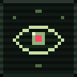
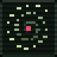
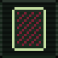
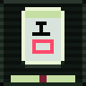
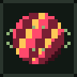
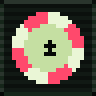
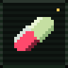
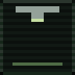

<!-- if you're reading the source, you're one of us. -->

   odds">

 

  builds quiet things. mostly for ios. 
  some of them are finished.

 

 

<code>&gt; ls ~/released</code>

   &nbsp;<a href="https://apps.apple.com/app/id1564639558"><code>oracle</code></a> &nbsp;knows more than it says. 
   &nbsp;<a href="https://apps.apple.com/app/id6759371512"><code>voidbound</code></a> &nbsp;counts, so you don't have to. 
   &nbsp;<a href="https://apps.apple.com/app/id6747075064"><code>flip &amp; score</code></a> &nbsp;everything is written down. 
   &nbsp;<a href="https://apps.apple.com/app/id6499211526"><code>riichiclub</code></a> &nbsp;keeps the score. keeps quiet. 
   &nbsp;<a href="https://apps.apple.com/app/id1627456078"><code>tmhelper</code></a> &nbsp;tracks what you'd forget. 
   &nbsp;<a href="https://apps.apple.com/app/id1547807748"><code>pokerlog</code></a> &nbsp;remembers.

 

<code>&gt; ps aux | grep wip</code>

   &nbsp;<code>capsula</code> &nbsp;every dose has its hour. 
   &nbsp;<code>drip</code> &nbsp;one drop at a time. 
   &nbsp;<code>pokerlog 2.0</code> &nbsp;rewriting itself. 
  <code>░░</code> &nbsp;<code>████████</code> &nbsp;you'll know when you see it.

 

<code>▓▓▓</code>

you opened it anyway. 
<a href="mailto:Mihomailian@gmail.com">open a channel</a> — replies are not guaranteed.

<code>// you were never here.</code>

