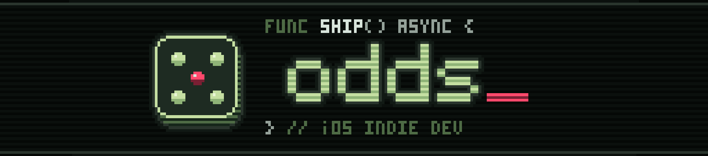
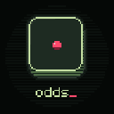
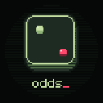
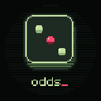
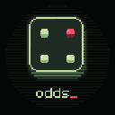
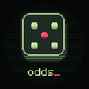
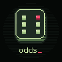
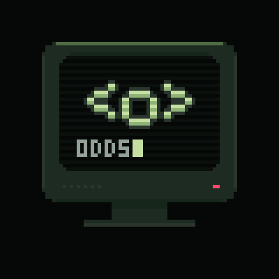
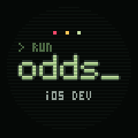

<p align="center">
  
</p>

<p align="center">
  
</p>

<p align="center">
  
  
  
  
  
  
</p>

<p align="center"><sub><code>one of them is lying.</code></sub></p>

---



```
> whoami
  [REDACTED]

> locate --self
  somewhere between a compiler and a card table

> cat /etc/motive
  the house always wins.
  unless the house is written in Swift.

> uptime
  since the first roll. nobody remembers when.
```

<br clear="right">

### `> ls ~/released`

| | app | signal |
|:-:|---|---|
| 🔮 | [**Oracle: Find the Mole**](https://apps.apple.com/app/id1564639558) | *trust no one. not even the one who asked.* |
| 🌀 | [**Voidbound: Sorcery TCG**](https://apps.apple.com/app/id6759371512) | *the void counts your life points so you don't have to.* |
| 🃏 | [**Flip & Score**](https://apps.apple.com/app/id6747075064) | *push your luck. it will be written down.* |
| 🀄 | [**RiichiClub**](https://apps.apple.com/app/id6499211526) | *the tiles are silent. the scoreboard is not.* |
| 🪐 | [**TMHelper**](https://apps.apple.com/app/id1627456078) | *mars won't terraform itself. but it will be tracked.* |
| ♠️ | [**PokerLog**](https://apps.apple.com/app/id1547807748) | *the house always remembers.* |

### `> ls ~/satellites`

<sub>small things orbiting the bigger ones.</sub>

```
drwxr-xr-x  home-poker        the bank. the blinds. the debts. settled in silence.
drwxr-xr-x  pokerlog-site     where the log leaves its manual.
drwxr-xr-x  pokerlog-ideas    whispers from players, pinned to a board.
```

[`Home-Poker`](https://github.com/OutOfOdds/Home-Poker) · [`PokerLog-Site`](https://github.com/OutOfOdds/PokerLog-Site) · [`pokerlog-ideas`](https://github.com/OutOfOdds/pokerlog-ideas)

### `> ps aux | grep wip`

```
PID    STATE       PROCESS         NOTE
0x07   on-time     capsula         every dose has its hour. it remembers, so you don't have to.
0x0D   dripping    drip            slowly. one drop at a time.
0x2A   rewriting   pokerlog 2.0    the log is learning new tricks.
0x??   ??????      ████████        and something else. you'll know when you see it.
```

[`→ all signals on the App Store`](https://apps.apple.com/us/developer/mike-mailyan/id1547807750)

### `> strings ./odds | head`

<p>
  
  
  
</p>

```swift
enum Odds {
    case good
    case bad
    case outOf   // ← you are here
}
```

### `> transmit`

<a href="mailto:Mihomailian@gmail.com"></a>

<sub>replies are not guaranteed. but they are likely.</sub>

---

<p align="center">
  <br>
  <sub><code>// end of transmission. roll again?</code></sub>
</p>
